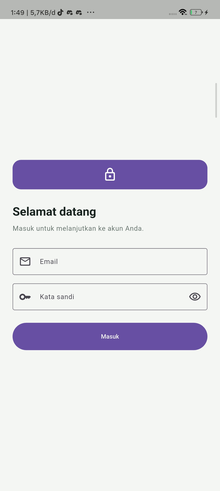
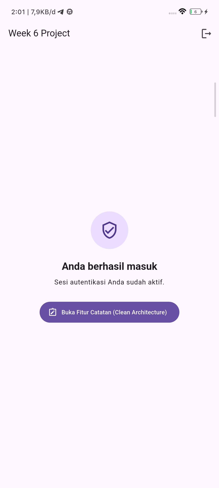
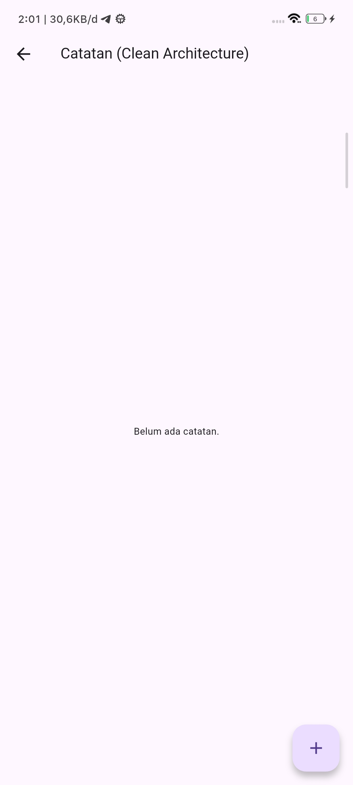
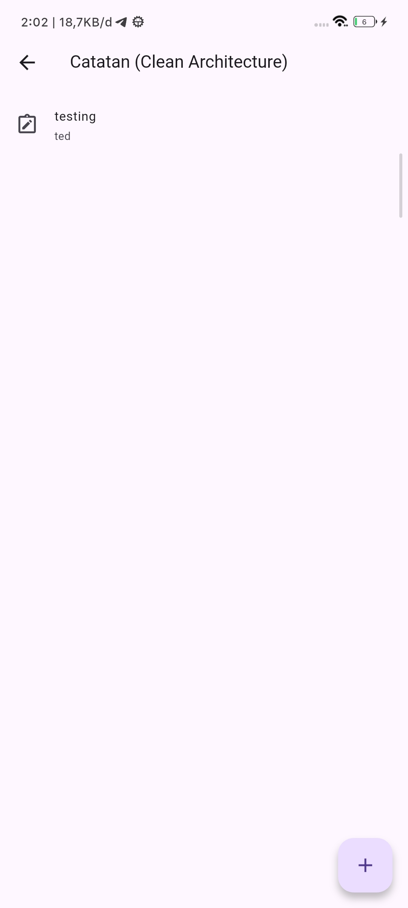
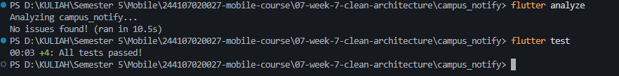

|            | Pemrograman Mobile                                                                                    |
| ---------- | ----------------------------------------------------------------------------------------------------- |
| NIM        | 244107020027                                                                                          |
| Nama       | Muhammad Rayhan Zamzami                                                                               |
| Kelas      | TI - 3G                                                                                               |
| Repository | [link](https://github.com/mrayhanz/244107020027-mobile-course/tree/main/07-week-7-clean-architecture) |

# WEEK 7: CLEAN ARCHITECTURE (FEATURE-FIRST)

## 1. Ringkasan & Tujuan Proyek

Praktikum ini merefactor proyek `campus_notify` dari struktur layer tercampur menjadi arsitektur berbasis **Clean Architecture dengan pendekatan Feature-First**.

Fokus utama pemisahan layer:

1. **Aturan Dependensi (Dependency Rule)**: Presentation dan Data layer bergantung ke dalam menuju Domain layer. Domain layer murni bahasa Dart tanpa referensi framework UI, database (`sqflite`), storage (`FlutterSecureStorage`), maupun network client (`Dio`).
2. **Modular Feature-First**: Kode dipisahkan per fitur bisnis (`auth`, `announcements`, `notes`) agar setiap fitur dapat dipelihara dan diuji secara independen.
3. **Penerapan Prinsip SOLID**: Memisahkan interface abstraksi dari implementasi konkret (DIP), membatasi tugas tiap berkas (SRP), dan memudahkan pengujian dengan repository palsu / fake (LSP).

---

## 2. Diagram Layer & Arah Dependensi

```text
       Presentation Layer (Widgets, Pages, Riverpod Notifiers)
                            │
                            ▼ (bergantung ke)
          Domain Layer (Entities, Repository Interfaces, Use Cases)
                            ▲
                            │ (diimplementasikan oleh)
           Data Layer (Models, Repository Impl, Data Sources)
```

**Dependency Rule:** Panah dependensi hanya mengarah ke dalam. Layer `domain` tidak mengetahui keberadaan Flutter, Dio, SQLite, maupun Firebase.

---

## 3. Struktur Folder Proyek

```text
campus_notify/lib/
├── core/
│   ├── failures.dart                              # Objek Failure domain (sealed class)
│   ├── format.dart                                # Fungsi murni formatting & parsing route
│   └── network/
│       ├── api_client.dart                        # Dio client & interceptor global
│       └── api_errors.dart                        # Mapping respons error HTTP
│
├── features/
│   ├── auth/
│   │   ├── domain/
│   │   │   ├── entities/auth_session.dart         # Entity murni sesi autentikasi
│   │   │   ├── repositories/auth_repository.dart  # Interface kontrak autentikasi
│   │   │   └── usecases/login_usecase.dart        # Logika validasi bisnis & login
│   │   ├── data/
│   │   │   ├── datasources/token_store.dart       # Enkapsulasi secure storage
│   │   │   ├── models/auth_session_model.dart     # Serialisasi JSON & mapper toEntity()
│   │   │   └── repositories/auth_repository_impl.dart
│   │   └── presentation/
│   │       ├── providers/auth_providers.dart      # DI Riverpod & AuthNotifier
│   │       └── pages/login_page.dart              # UI autentikasi
│   │
│   ├── announcements/
│   │   ├── domain/
│   │   │   ├── entities/announcement.dart         # Entity pengumuman
│   │   │   ├── repositories/announcement_repository.dart
│   │   │   └── usecases/get_announcements.dart
│   │   ├── data/
│   │   │   ├── models/announcement_model.dart
│   │   │   └── repositories/announcement_repository_impl.dart
│   │   └── presentation/
│   │       ├── providers/announcement_providers.dart
│   │       └── pages/
│   │           ├── home_page.dart
│   │           └── announcement_page.dart
│   │
│   └── notes/
│       ├── domain/
│       │   ├── entities/note.dart
│       │   ├── repositories/note_repository.dart
│       │   └── usecases/
│       │       ├── get_notes.dart
│       │       └── add_note.dart
│       ├── data/
│       │   ├── models/note_model.dart
│       │   └── repositories/note_repository_impl.dart
│       └── presentation/
│           ├── providers/notes_providers.dart
│           └── pages/notes_page.dart
│
├── messaging/
│   └── push_service.dart                          # External Firebase Messaging handler
├── routes.dart                                    # Konfigurasi GoRouter
└── main.dart                                      # Bootstrap & ProviderScope
```

---

## 4. Evaluasi Mandiri Terhadap Usulan AI (AI Verification Checklist)

Audit kritis dilakukan terhadap usulan dan kode hasil AI dengan kriteria berikut:

| Poin Verifikasi                          |     Status      | Catatan & Analisis Mandiri                                                                                                                                                                                                                                                        |
| :--------------------------------------- | :-------------: | :-------------------------------------------------------------------------------------------------------------------------------------------------------------------------------------------------------------------------------------------------------------------------------- |
| **Interface di Domain vs Impl di Data**  |   **Sesuai**    | Seluruh kontrak abstract repository diletakkan di `domain/repositories/`, sedangkan berkas implementasinya berada di `data/repositories/`. Tidak ada pencampuran dalam satu folder.                                                                                               |
| **Domain Steril dari Framework**         |   **Sesuai**    | Layer domain 100% menggunakan kode Dart murni. Tidak ada satupun impor `flutter`, `dio`, `sqflite`, maupun `firebase` pada folder `domain`.                                                                                                                                       |
| **Pencegahan Over-Engineering Use Case** | **Disesuaikan** | Usulan awal AI yang membuat use case terpisah untuk setiap operasi CRUD satu-baris dibatasi. Use case hanya diterapkan pada operasi yang memiliki logika bisnis nyata (`LoginUseCase`). Operasi baca sederhana langsung dipanggil Notifier melalui interface abstract repository. |
| **Entity Bebas dari Serialisasi Data**   |   **Sesuai**    | Method `toMap()`, `fromMap()`, dan `toJson()` hanya ada di layer Data (`*_model.dart`). Entity di domain bersih hanya memuat properti `const` tanpa parsing JSON/DB.                                                                                                              |
| **Wiring DI Terpusat di Riverpod**       |   **Sesuai**    | Widget tidak melakukan instansiasi manual (`new Repository()`). Semua dependensi diinjeksi melalui provider Riverpod di layer presentation.                                                                                                                                       |

---

## 5. REFLEKSI

### 1. Mengapa interface repository harus tinggal di domain, bukan di data? Apa yang rusak bila dibalik?

Berdasarkan prinsip **Dependency Inversion (DIP)**, logika bisnis level tinggi (domain) tidak boleh bergantung pada detail implementasi level rendah (data/API/database).
Jika antarmuka diletakkan di data layer, maka layer domain terpaksa mengimpor layer data. Hal tersebut membalik arah panah dependensi (_circular/wrong dependency_). Akibatnya, saat ada perubahan sumber data (misalnya mengganti SQLite ke database lain atau merestrukturisasi API), layer domain akan ikut rusak dan tidak bisa diuji secara murni tanpa data layer.

### 2. Kapan use case benar-benar dibutuhkan, dan kapan repository langsung ke notifier sudah cukup?

Use case benar-benar dibutuhkan saat:

- Terdapat aturan bisnis murni atau validasi sebelum memanggil repository (misal: validasi panjang dan format kredensial login, enkripsi payload).
- Operasi menggabungkan lebih dari satu repository/sumber data (misal: login memanggil API auth, lalu menyimpan sesi ke secure storage, lalu mendaftarkan token ke service push notification).

Sebaliknya, pada operasi read-only sederhana yang hanya meneruskan pemanggilan satu baris tanpa pengolahan tambahan, memanggil interface repository langsung dari notifier sudah cukup. Hal ini menghemat kode berulang tanpa melanggar prinsip arsitektur karena notifier tetap memegang abstraksi antarmuka.

### 3. Apa biaya over-engineering (use case per CRUD satu-baris) bagi tim kecil? Kapan biayanya sepadan?

Biaya over-engineering bagi tim kecil adalah bertambahnya berkas proyek secara drastis (_boilerplate & file bloat_) yang memperlambat kecepatan pengembangan dan mempersulit navigasi kode tanpa memberikan nilai tambah logika. Biaya ini sepadan ketika diaplikasikan pada proyek berskala besar (_enterprise_) dengan banyak pengembang paralel, di mana alur bisnis sangat kompleks dan memerlukan unit test terisolasi pada setiap use case.

### 4. Bagian mana dari usulan AI yang Anda tolak atau sederhanakan, dan mengapa?

Bagian yang ditolak/disederhanakan:

- Menolak pembuatan use case terpisah untuk setiap operasi CRUD sederhana (misalnya detail pengumuman) untuk menghindari _boilerplate_ yang tidak perlu.
- Mengganti kebiasaan melempar exception mentah (_raw exception_) dengan tipe kembalian **Dart Record** `({T? data, Failure? failure})`. Pola ini membuat penanganan status berhasil atau gagal menjadi eksplisit, _type-safe_, serta mencegah UI berhenti mendadak akibat _unhandled exception_.

---

## 6. HASIL PRAKTIKUM

## 

## 

## 

## 


