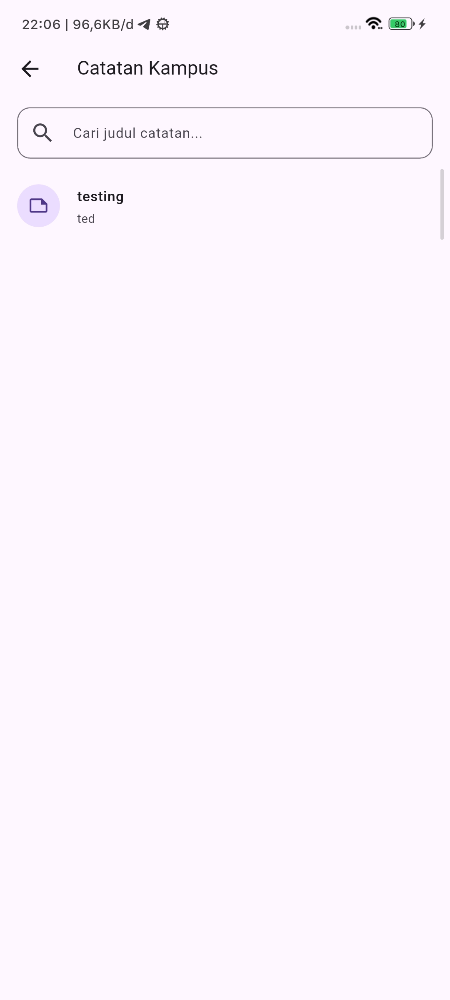
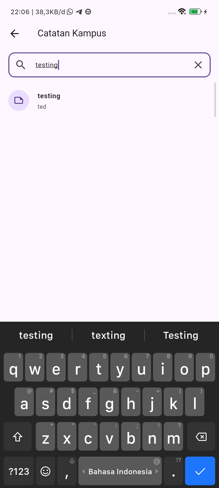
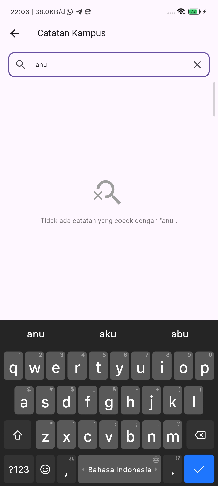
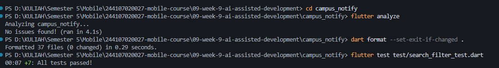

|            | Pemrograman Mobile                                                                                     |
| ---------- | ------------------------------------------------------------------------------------------------------ |
| NIM        | 244107020027                                                                                           |
| Nama       | Muhammad Rayhan Zamzami                                                                                |
| Kelas      | TI - 3G                                                                                                |
| Repository | [link](https://github.com/mrayhanz/244107020027-mobile-course/tree/main/09-week-9-ai-assisted-development) |

# WEEK 9 — AI-Assisted Development & Vibe Coding

---

### Praktikum 1 — Prompt & Context Engineering

#### 1. Formula 5 Slot Prompting
```text
Peran: Senior Flutter Developer & Clean Architecture Specialist
Konteks: Clean Architecture (presentation -> domain <- data), Riverpod (v3), SQLite, Dio
Tugas: Tambah fitur search judul notes + empty state
Batas: Jangan ubah arsitektur, jangan panggil SQLite dari widget, domain murni Dart, fungsi maks 40 baris
Output: Use case domain + Notifier Riverpod + UI NotesPage + 3 unit & widget test
```

#### 2. Buruk vs Baik
| Format | Prompt | Analisis |
|---|---|---|
| **Buruk** | *"Buatkan search notes yang keren"* | Logika menumpuk di widget, manggil DB langsung, case-sensitive, tanpa handling empty state & test. |
| **Baik** | *"Tambah search judul notes. Arsitektur: presentation->domain<-data. Jangan panggil SQLite dari widget. Sertakan empty state + 1 widget test."* | Kode modular, batasan layer jelas, use case murni, pemisahan state di notifier, teruji otomatis. |

#### 3. Context vs Secret
- **Wajib Disertakan:** Struktur folder fitur, entity `Note`, kontrak `NoteRepository`, versi library di `pubspec.yaml`.
- **Dilarang Disertakan:** Token FCM, payload JWT auth, credential database, API key. Gunakan placeholder (misal: `TOKEN_PLACEHOLDER`).

---

### Praktikum 2 — Generate & Verifikasi Search

#### 1. Verifikasi 6 Langkah
1. **Baca Baris demi Baris:** Draf awal AI pakai `contains(query)` tanpa konversi lowercase (case-sensitive).
2. **Cek Import Domain:** Ditemukan impor ilegal `package:flutter/material.dart` di layer domain, langsung dihapus.
3. **Cek API & Versi Library:** AI pakai `StateProvider<String>` yang usang di Riverpod 3. Diubah ke `NotifierProvider` + class `Notifier<String>`.
4. **Static Analysis:** `flutter analyze` bersih (0 error/warning).
5. **Automated Test:** Dibuat pengujian unit kata kunci cocok dan kata kunci tidak ada (`zzz-tak-ada`).
6. **Uji Manual:** Query kosong (tampil semua), query cocok (tersaring), query tak cocok (tampil ikon `search_off` & pesan informatif).

#### 2. Bukti Halusinasi & Bug AI
1. **Halusinasi Framework di Domain:**  
   Grep `package:flutter` di `lib/features/notes/domain/` menemukan impor Flutter di usecase `search_notes.dart`. Melanggar aturan domain murni Dart.
2. **Bug Case-Sensitivity:**  
   Unit test `filterNotes(list, 'belanja')` gagal (`Expected: 2, Actual: 0`) karena catatan tersimpan huruf kapital (`Belanja Bulanan` & `Daftar BELANJA Lab`).

---

### Praktikum 3 — Debug & Refactor

#### 1. Debug Siklus Test Merah (Red-Green-Refactor)
1. **Reproduksi:** Query `'belanja'` menghasilkan list kosong pada judul bercampur kapital.
2. **Isolasi:** Pindah algoritma filter ke pure usecase `SearchNotes` di domain layer.
3. **Test Merah:** Tulis unit test pembukti bug di `test/search_filter_test.dart`.
4. **Fix (Green):** Normalisasi dengan `.trim().toLowerCase()`:
   ```dart
   class SearchNotes {
     const SearchNotes();

     List<Note> call(List<Note> notes, String query) {
       final sanitized = query.trim().toLowerCase();
       if (sanitized.isEmpty) return notes;
       return notes.where((n) => n.title.toLowerCase().contains(sanitized)).toList();
     }
   }
   ```
5. **Catat Masalah:** String matching bawaan Dart bersifat ordinal/case-sensitive, butuh sanitasi manual.

#### 2. Refactor ke Layer yang Benar
```text
Widget (UI: NotesPage & _NotesSearchHeader)
  │
  ▼
Notifier (State: NoteSearchQueryNotifier)
  │
  ▼
Use Case (Aturan filter: SearchNotes)
  │
  ▼
Repository (Data: NoteRepository / SQLite)
```
- **Fungsi Maks 40 Baris:** Didekomposisi jadi `_NotesSearchHeader` (27 baris), `_NotesListView` (19 baris), `_NotesEmptyState` (28 baris).
- **Sterilisasi Widget:** `notes_page.dart` tidak memanggil SQLite atau network langsung.

---

### AI Challenge

#### 1. Prompt Review
```text
Review kode search Flutter ini sebagai senior dev.
Konteks: feature-first (presentation->domain<-data), Riverpod, SQLite + Dio.
Fokus: kebenaran, arsitektur, test. Abaikan style.
Beri 3 temuan + level blocker/saran + alasan.
```

#### 2. Tabel Usulan vs Keputusan

| No | Temuan AI | Level | Bukti / Verifikasi | Keputusan | Alasan Teknis |
|---|---|---|---|:---:|---|
| 1 | Wajib pakai method Notifier (`setQuery` / `clear`) | Blocker | Riverpod 3 menjamin enkapsulasi state via Notifier class | **Diterima** | Mencegah mutasi state ad-hoc langsung dari UI. |
| 2 | Pindahkan search ke SQLite query `LIKE %query%` | Saran | In-memory filter vs disk I/O benchmark | **Ditolak** | Data lokal sudah di-cache di Riverpod. Query disk async tiap keystroke memicu lock SQLite & UI lag. Filter in-memory sinkron (<1ms) & offline-ready. |
| 3 | Pecah komponen UI jadi sub-widgets terpisah | Saran | Pengukuran baris fungsi `build()` | **Diterima** | Fungsi `build()` ringkas (<30 baris) dan komponen empty state bisa diuji terpisah. |

#### 3. Keputusan Berkas
- `search_notes.dart`: **Terima + Refactor** (Pure use case tanpa dependensi framework, case-insensitive).
- `notes_providers.dart`: **Terima + Refactor** (Riverpod 3 `NotifierProvider` & reactive `filteredNotesProvider`).
- `notes_page.dart`: **Terima + Refactor** (Dekomposisi widget, event-driven notifier call, tombol clear).
- `search_filter_test.dart`: **Tulis Manual** (Unit test domain + widget test interaksi).

---

### Testing & Verifikasi Akhir

#### 1. Automated Test
```bash
flutter test test/search_filter_test.dart
```
Hasil: 4 unit test domain + 3 widget test lolos (100% Green).

#### 2. Uji Manual 3 Query

| Query Kosong | Query Cocok ("testing") | Query Tak Cocok (Empty State) |
|:---:|:---:|:---:|
|  |  |  |
| *Tampil seluruh catatan awal.* | *Menyaring judul (case-insensitive).* | *Ikon `search_off` & pesan informatif.* |

#### 3. Ringkasan Mesin Hijau
- `flutter analyze`: No issues found!
- `dart format --set-exit-if-changed .`: Formatted 37 files (0 changed).
- `flutter test`: All 16 tests passed!



---

### Refleksi

1. **Halusinasi AI:** AI memasukkan `import 'package:flutter/material.dart'` di domain use case (dibuktikan via `grep`) dan memakai `StateProvider<String>` yang usang di Riverpod 3 (dibuktikan via compile error).
2. **Prompt Paling Membantu:** Formula 5 slot dengan penegasan **Batas (Constraints)**: melarang impor framework di domain dan membatasi ukuran fungsi maks 40 baris.
3. **Refactor yang Dilakukan:** Memecah `NotesPage` monolitik (>85 baris) menjadi 4 sub-widget modular dan memindahkan logika filter ke pure use case `SearchNotes`.
4. **Keputusan Paling Sulit:** Menolak saran SQLite query `LIKE` pada pencarian lokal, karena filter in-memory pada data cache Riverpod jauh lebih responsif tanpa disk I/O overhead.
