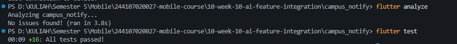
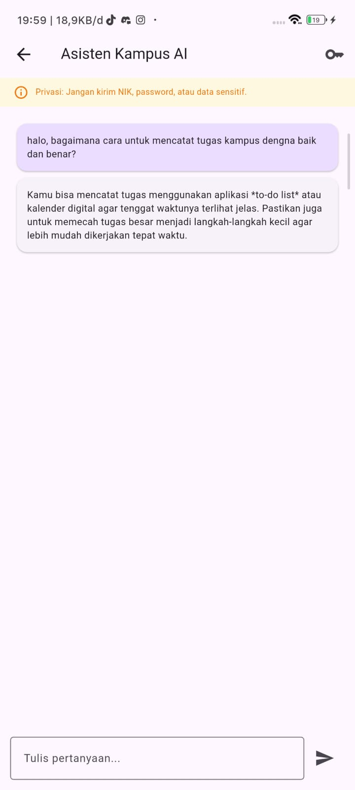

|            | Pemrograman Mobile                                                                                         |
| ---------- | ---------------------------------------------------------------------------------------------------------- |
| NIM        | 244107020027                                                                                               |
| Nama       | Muhammad Rayhan Zamzami                                                                                    |
| Kelas      | TI - 3G                                                                                                    |
| Repository | [link](https://github.com/mrayhanz/244107020027-mobile-course/tree/main/10-week-10-ai-feature-integration) |

# WEEK 10

## AI Feature Integration

### HASIL PRAKTIKUM

#### 1. Integrasi Fitur AI

Pada Week 10 diintegrasikan fitur **Asisten Kampus AI** berbasis Gemini API (`gemini-3.1-flash-lite`) pada project `campus_notify`. Fitur ini memungkinkan pengguna mengirim pertanyaan seputar kampus atau fitur aplikasi secara langsung ke model LLM Google Gemini.

Fitur berada di folder:

```text
campus_notify/lib/features/ai/
├── data/
│   └── ai_service.dart
└── presentation/
    ├── ai_chat_page.dart
    └── ai_chat_provider.dart
```

Stack integrasi:

- `Dio` untuk REST client ke endpoint Google Generative Language.
- `flutter_secure_storage` untuk enkripsi penyimpanan Gemini API key di perangkat.
- `flutter_riverpod` (v3 `NotifierProvider`) untuk state management chat & loading indicator.

#### 2. Service Gemini & Keamanan Key

Komunikasi ke API ditangani oleh `GeminiAiService`:

```dart
final response = await _dio.post<Map<String, dynamic>>(
  _endpoint,
  queryParameters: {'key': key},
  data: {
    'contents': [
      {
        'parts': [
          {'text': question},
        ],
      },
    ],
  },
);
```

API key tidak di-hardcode ke source code. User menginputkan key lewat dialog pengaturan pada UI, lalu disimpan aman via `FlutterSecureStorage`.

#### 3. System Prompt & Proteksi Privasi

Prompt sistem yang digunakan:

```text
Kamu asisten kampus ramah. Jawab dalam Bahasa Indonesia,
maksimal 2 kalimat. Jangan meminta atau mengungkap data pribadi.
```

Pada UI disertakan banner peringatan privasi agar user tidak mengirim data sensitif (NIK, password, token).

#### 4. UI Chat & Error Handling

- State loading menampilkan progress indicator saat request diproses ke server Gemini.
- Tombol kirim dinonaktifkan saat input kosong atau proses loading berjalan (mencegah double request).
- Error rate limit (`429`), key kosong, atau koneksi timeout ditangkap dan ditampilkan sebagai pesan user-friendly tanpa mengekspos exception stack trace.

### PENGUJIAN

#### 1. Static Analysis & Unit Test

```bash
flutter analyze
flutter test
```

Hasil:

```text
flutter analyze: No issues found!
flutter test: 16 tests passed!
```

#### 2. Bukti Screenshot




### TABEL RISIKO & MITIGASI

| Kategori Risiko             | Potensi Masalah                                   | Mitigasi Teknis                                                                |
| --------------------------- | ------------------------------------------------- | ------------------------------------------------------------------------------ |
| **Keamanan Secret**         | API key bocor ke git repository publik            | Key tidak ditulis di code/commit; disimpan di `flutter_secure_storage`.        |
| **Privasi Pengguna**        | Data identitas/kredensial terkirim ke LLM         | Banner warning di UI + system prompt melarang data pribadi.                    |
| **Biaya & Kuota**           | Spam request dan pemborosan token                 | Disable button saat loading, validasi input kosong, prompt dibatasi 2 kalimat. |
| **Konektivitas / API Down** | Crash atau unhandled exception saat request gagal | Error mapping pada `AiException` (status 429, timeout, network error).         |

### REFLEKSI

1. **Fitur AI:**
   Chatbot Asisten Kampus (Gemini API). Simpel, relevan untuk info kampus, dan tidak butuh izin kamera/mic.
2. **Privasi:**
   API key disimpan di `flutter_secure_storage` (bukan di code), ada banner peringatan privasi, dan system prompt melarang minta data sensitif.
3. **Fallback:**
   Error di-catch jadi pesan user-friendly (koneksi/kuota/key salah) di balon chat, app tidak crash.
4. **Pelajaran UX:**
   Tombol kirim wajib disable saat loading biar tidak double request dan error harus jelas.
