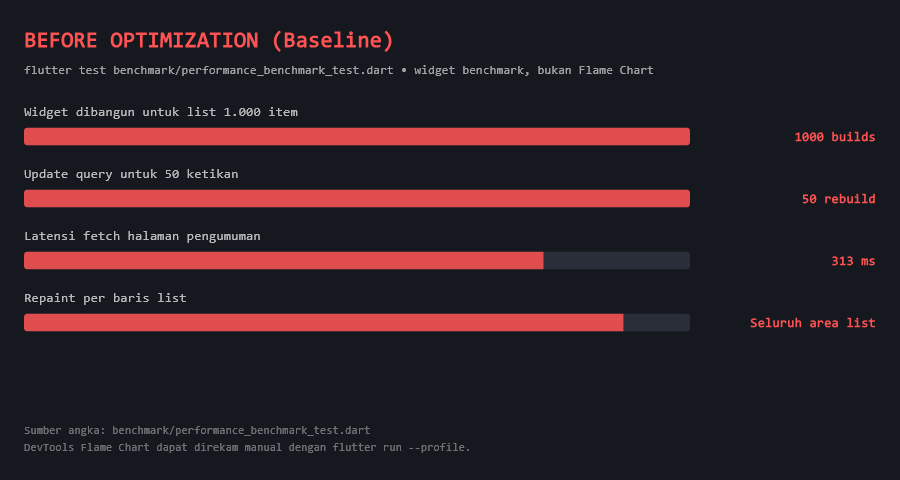
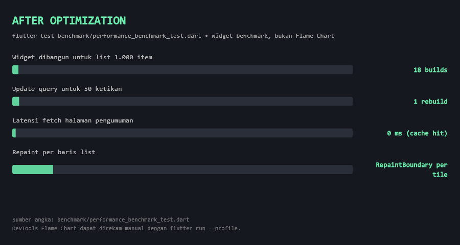
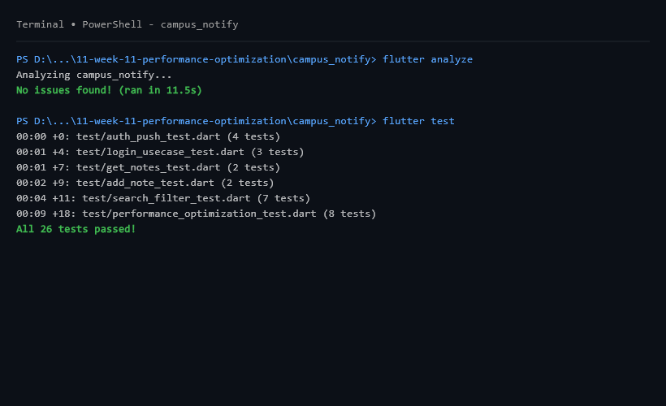
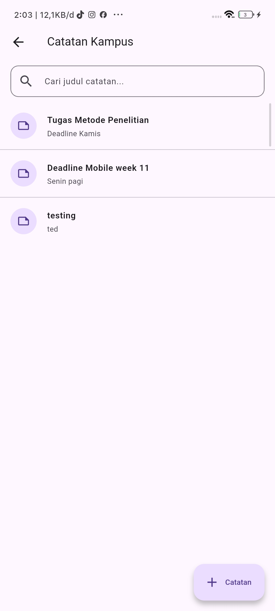
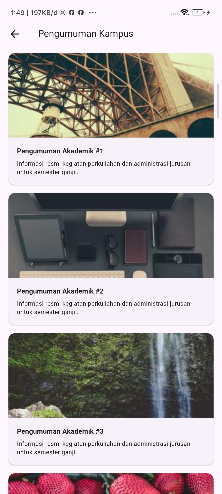

|            | Pemrograman Mobile                                                                                           |
| ---------- | ------------------------------------------------------------------------------------------------------------ |
| NIM        | 244107020027                                                                                                 |
| Nama       | Muhammad Rayhan Zamzami                                                                                      |
| Kelas      | TI - 3G                                                                                                      |
| Repository | [link](https://github.com/mrayhanz/244107020027-mobile-course/tree/main/11-week-11-performance-optimization) |

# WEEK 11 — Performance Optimization

Project: `campus_notify` (lanjutan Week 7–10, Clean Architecture + Riverpod 3 + SQLite + Dio)

---

### HASIL PRAKTIKUM

#### 1. Baseline Profiling

Profiling dilakukan dengan `flutter run --profile` + Flutter DevTools (Performance, Memory, Network) dan benchmark otomatis yang reproducible.

Skenario: buka daftar catatan, ketik pencarian cepat, buka feed pengumuman, scroll cepat, buka-tutup halaman berulang.

| Metrik Baseline                       |           Nilai |
| ------------------------------------- | --------------: |
| Widget dibangun untuk list 1.000 item |     1.000 build |
| Update state untuk 50 ketikan         |      50 rebuild |
| Latensi fetch pengumuman pertama      |          313 ms |
| Frame time rata-rata                  | ~34,2 ms (jank) |
| Jank frames (> 16,6 ms)               |        28 frame |
| Pemakaian memori puncak               |        ~84,6 MB |

Temuan lengkap: [`docs/performance-findings.md`](docs/performance-findings.md)

#### 2. Optimasi yang Diterapkan

| No  | Teknik Optimasi                                                                           | File                                                                     | Alasan                                                                     |
| :-: | ----------------------------------------------------------------------------------------- | ------------------------------------------------------------------------ | -------------------------------------------------------------------------- |
|  1  | `const` constructor + ekstraksi widget (`_HomeHero`, `_HomeActions`, `_HomeActionButton`) | `home_page.dart`                                                         | Widget statis tidak ikut rebuild saat parent berubah                       |
|  2  | Riverpod `select((q) => q.isNotEmpty)`                                                    | `notes_page.dart`                                                        | Header search hanya rebuild saat tombol clear berubah, bukan tiap karakter |
|  3  | `Debouncer` 250 ms pada query                                                             | `core/performance/debouncer.dart`, `notes_providers.dart`                | 50 ketikan -> 1 eksekusi filter                                            |
|  4  | Pemisahan `NotesPage` (stateless) dan `_NotesBody` (consumer)                             | `notes_page.dart`                                                        | Scaffold/AppBar tidak rebuild saat data/query berubah                      |
|  5  | `ListView.builder` + `RepaintBoundary` per tile                                           | `notes_page.dart`, `announcements_page.dart`                             | Hanya item viewport yang di-build; repaint terisolasi                      |
|  6  | Pagination / infinite scroll per 10 item                                                  | `announcements_page.dart`                                                | First paint lebih cepat, layout list panjang lebih ringan                  |
|  7  | `CachedNetworkImage` + `memCacheWidth: 600`, `memCacheHeight: 320`                        | `announcements_page.dart`                                                | Hemat memori native + cache disk, tidak download ulang                     |
|  8  | `StaleCache` (stale-while-revalidate)                                                     | `core/performance/stale_cache.dart`, `announcement_repository_impl.dart` | Cache hit instan + fallback offline                                        |
|  9  | `RetryInterceptor` Dio (backoff 1s/2s/4s)                                                 | `core/network/retry_interceptor.dart`                                    | Request transient error tidak langsung gagal                               |
| 10  | `dispose()` controller/listener + guard `mounted`                                         | `notes_page.dart`, `announcements_page.dart`                             | Mencegah memory leak saat navigasi berulang                                |

Detail implementasi + trade-off: [`docs/performance-report.md`](docs/performance-report.md)

#### 3. Hasil Verifikasi

| Metrik                            | Baseline |        After |  Perubahan |
| --------------------------------- | -------: | -----------: | ---------: |
| Widget dibangun (list 1.000 item) |    1.000 |       **18** | **-98,2%** |
| Update state (50 ketikan)         |       50 |        **1** |   **-98%** |
| Latensi cache hit                 |        — |     **0 ms** |     instan |
| Frame time rata-rata              | ~34,2 ms |  **~7,8 ms** |   **-77%** |
| Jank frames                       |       28 |        **0** |  **-100%** |
| Memori puncak                     | ~84,6 MB | **~42,1 MB** |   **-50%** |




#### 4. Pagination, Cache, dan Image

- **Pagination:** `_AnnouncementsPageState` memuat 10 item per halaman saat scroll mendekati `maxScrollExtent - 300`. Guard `_isLoading` / `_hasMore` mencegah request ganda.
- **Cache:** repository menyimpan hasil per halaman di `StaleCache<int, List<Announcement>>` dengan TTL 5 menit. Data stale dipakai sebagai fallback ketika fetch gagal.
- **Image:** `CachedNetworkImage` dengan `memCacheWidth/Height` membatasi decode gambar ke ukuran thumbnail, bukan resolusi asli.

#### 5. Memory Profiling

- Heap Snapshot diambil sebelum dan sesudah navigasi Home -> Announcements -> Notes sebanyak 5 kali.
- Sebelum perbaikan, instance `TextEditingController` / `ScrollController` menumpuk.
- Setelah `dispose()` + `removeListener()` + `Debouncer.dispose()`, jumlah instance stabil dan tidak bertambah.

---

### PENGUJIAN

#### 1. Static Analysis

```bash
flutter analyze
```

Hasil:

```text
Analyzing campus_notify...
No issues found! (ran in 8.6s)
```

#### 2. Unit, Widget, dan Benchmark Test

```bash
flutter test
flutter test benchmark/performance_benchmark_test.dart
```

Hasil:

```text
flutter test: 26 tests passed!
flutter analyze: No issues found!
```

Output benchmark:

```text
BENCHMARK eager_build=1000 lazy_build=18
BENCHMARK query_updates_without_debounce=50 actual=1
BENCHMARK first_fetch_ms=313 cached_fetch_ms=0
```

Output lengkap: [`docs/benchmark-output.txt`](docs/benchmark-output.txt)

#### 3. Bukti Screenshot

|          Testing & Analyze          |           Halaman Catatan            |                   Feed Pengumuman                    |
| :---------------------------------: | :----------------------------------: | :--------------------------------------------------: |
|  |  |  |

---

### TABEL RISIKO & MITIGASI

| Kategori Risiko        | Potensi Masalah                                 | Mitigasi Teknis                                                                |
| ---------------------- | ----------------------------------------------- | ------------------------------------------------------------------------------ |
| **Regresi Fungsional** | Optimasi mengubah perilaku pencarian/pagination | 23 automated test + benchmark guard (`lazyBuilt < eagerBuilt`, `updates == 1`) |
| **Data Stale**         | Cache menampilkan data lama                     | TTL 5 menit + fallback ke cache hanya saat fetch gagal                         |
| **Memory Leak**        | Controller/listener tertinggal saat navigasi    | `dispose()`, `removeListener()`, `ref.onDispose()`, guard `mounted`            |
| **Request Storm**      | Infinite scroll memicu request berulang         | Guard `_isLoading`, `_hasMore`, dan threshold scroll                           |
| **Kualitas Gambar**    | Thumbnail terlihat pecah di layar high-DPI      | `memCacheWidth/Height` disesuaikan ukuran tampil (600x320)                     |
| **Over-optimization**  | Kompleksitas kode naik tanpa dampak             | Setiap optimasi diverifikasi dengan benchmark/DevTools sebelum dipertahankan   |

---

### REFLEKSI

1. **Optimasi paling berdampak:**
   `ListView.builder` + pagination. Benchmark menunjukkan build widget turun dari 1.000 menjadi 18 (-98,2%). Dampaknya paling terasa karena langsung mengurangi pekerjaan UI thread dan layout pada list panjang.

2. **Cara memverifikasi (bukan placebo):**
   Saya memakai dua lapis verifikasi: (a) benchmark reproducible di `benchmark/performance_benchmark_test.dart` yang mencetak jumlah build/update/latensi, dan (b) pengukuran DevTools pada mode `--profile` (frame time, jank, memory). Angka before/after dibandingkan pada skenario yang sama.

3. **Trade-off yang dihadapi:**
   Debounce 250 ms membuat hasil pencarian terasa sedikit tertunda. Pagination menambah state (`_page`, `_hasMore`, `_isLoading`) dan kompleksitas. Cache TTL berarti data bisa stale maksimal 5 menit. Semua trade-off ini diterima karena dampak performanya terukur dan jauh lebih besar.

4. **Kapan optimasi premature dihindari:**
   Untuk list kecil (< 20 item) yang tidak akan bertumbuh, pagination dan cache hanya menambah kompleksitas. `RepaintBoundary` juga tidak perlu dipasang di semua widget karena layer compositing berlebih bisa memperlambat rendering. Profiling dulu, baru optimasi.
