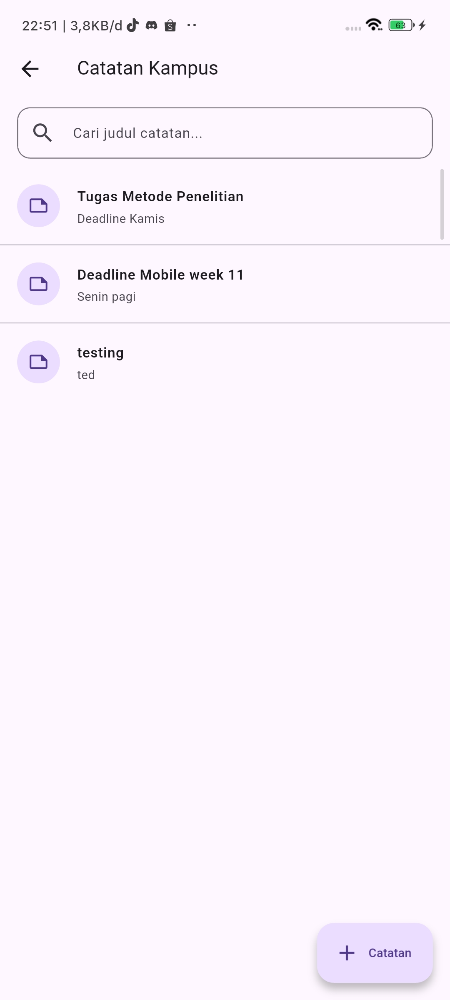
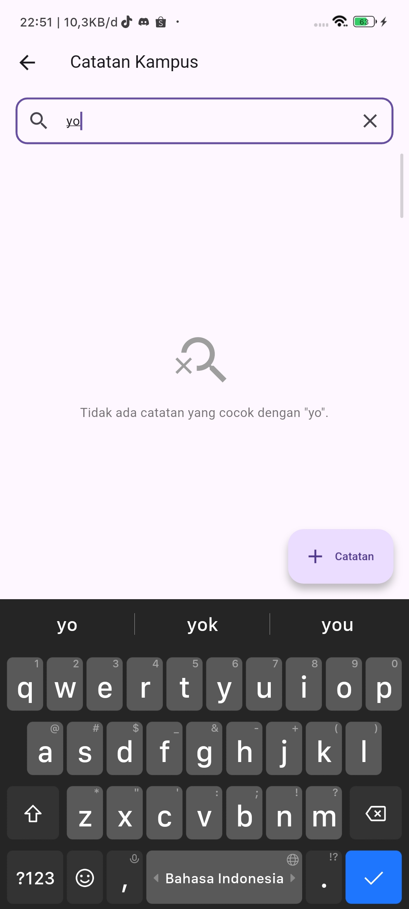
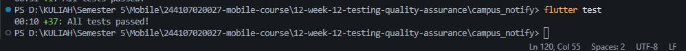
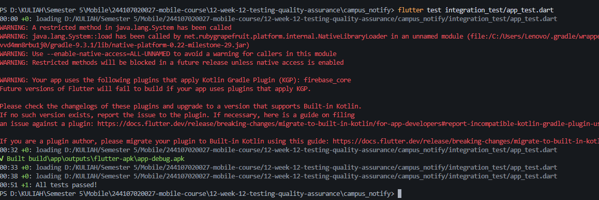

|            | Pemrograman Mobile                                                                                            |
| ---------- | ------------------------------------------------------------------------------------------------------------- |
| NIM        | 244107020027                                                                                                  |
| Nama       | Muhammad Rayhan Zamzami                                                                                       |
| Kelas      | TI - 3G                                                                                                       |
| Repository | [link](https://github.com/mrayhanz/244107020027-mobile-course/tree/main/12-week-12-testing-quality-assurance) |

# WEEK 12 — Testing & Quality Assurance

### HASIL PRAKTIKUM




#### 1. Piramida Pengujian yang Dipakai

| Jenis     | Yang diperiksa                                                       | Lokasi                                                                                                                                              | Jumlah |
| --------- | -------------------------------------------------------------------- | --------------------------------------------------------------------------------------------------------------------------------------------------- | -----: |
| Unit      | `AddNote`, `GetNotes`, `SearchNotes`, `LoginUseCase`, state auth     | `test/note_rules_test.dart`, `test/get_notes_test.dart`, `test/search_filter_test.dart`, `test/login_usecase_test.dart`, `test/auth_push_test.dart` |     23 |
| Widget    | State UI (`loading`, `error`, empty, list) + interaksi form & search | `test/notes_ui_test.dart`, `test/add_note_test.dart`, `test/search_filter_test.dart`, `test/performance_optimization_test.dart`                     |     13 |
| Integrasi | Alur tambah catatan -> tampil di list -> cari -> clear               | `test/app_flow_test.dart` (via `flutter test`), `integration_test/app_test.dart` (perangkat)                                                        | 1 (+1) |

Total: **37 pengujian** di `flutter test`, ditambah 1 pengujian integrasi perangkat.

#### 2. Kode Dirancang Agar Mudah Diuji

Aturan bisnis dipindahkan dari widget ke use case, sehingga bisa diuji tanpa merender UI. Repository tetap berupa abstraksi (`NoteRepository`) sehingga test mengganti SQLite dengan fake in-memory.

```dart
// lib/features/notes/domain/usecases/add_note.dart
Future<({Note? note, Failure? failure})> call({
  required String title,
  String body = '',
}) {
  final trimmedTitle = title.trim();
  if (trimmedTitle.isEmpty) {
    return Future.value((
      note: null,
      failure: const LocalFailure('Judul catatan wajib diisi.'),
    ));
  }
  return _repository.addNote(title: trimmedTitle, body: body.trim());
}
```

Fake repository pada test mengembalikan hasil sukses atau failure yang dikendalikan test, tanpa jaringan/SQLite:

```dart
class FakeNoteRepository implements NoteRepository {
  FakeNoteRepository({this.fail = false});

  final bool fail;
  int addCalls = 0;

  @override
  Future<({Note? note, Failure? failure})> addNote({
    required String title,
    String body = '',
  }) async {
    addCalls++;
    if (fail) {
      return (note: null, failure: const LocalFailure('db locked'));
    }
    return (note: Note(title: title, body: body, updatedAt: DateTime.now()), failure: null);
  }
}
```

#### 3. Skenario yang Diuji

| No  | Skenario                                                                    | Jenis                      | Hasil                                                                             |
| :-: | --------------------------------------------------------------------------- | -------------------------- | --------------------------------------------------------------------------------- |
|  1  | Judul berisi teks diterima                                                  | Unit                       | Lulus                                                                             |
|  2  | Judul kosong / hanya spasi / newline ditolak **tanpa** memanggil repository | Unit (kasus tepi)          | Lulus                                                                             |
|  3  | Spasi awal/akhir judul & isi dipangkas                                      | Unit (kasus tepi)          | Lulus                                                                             |
|  4  | Failure repository diteruskan apa adanya (tidak jadi daftar kosong)         | Unit (kegagalan)           | Lulus                                                                             |
|  5  | `GetNotes` meneruskan daftar dan failure                                    | Unit                       | Lulus                                                                             |
|  6  | `LoginUseCase` menolak email tidak valid & password < 6                     | Unit                       | Lulus                                                                             |
|  7  | Pencarian case-insensitive, query kosong mengembalikan semua                | Unit                       | Lulus                                                                             |
|  8  | Indikator loading tampil selama data dimuat                                 | Widget                     | Lulus                                                                             |
|  9  | Error tampil + tombol `Coba Lagi` memulihkan daftar                         | Widget (kegagalan)         | Lulus                                                                             |
| 10  | Judul kosong ditolak dengan pesan, data tidak tersimpan                     | Widget (input tidak valid) | Lulus                                                                             |
| 11  | Tambah catatan menyimpan & me-refresh daftar                                | Widget                     | Lulus                                                                             |
| 12  | Query menyaring list, tombol clear memulihkan list                          | Widget (interaksi)         | Lulus                                                                             |
| 13  | Empty state berbeda saat pencarian tidak menemukan hasil                    | Widget                     | Lulus                                                                             |
| 14  | Alur utama: tambah -> tampil -> cari -> empty state -> clear                | Integrasi                  | Lulus di emulator Android 13 (lihat bagian 5) |

#### 4. Hasil `flutter test` dan `flutter analyze`

```text
flutter test
00:29 +37: All tests passed!

flutter analyze
Analyzing campus_notify...
No issues found! (ran in 75.2s)
```



#### 5. Pengujian Integrasi di Perangkat

File: `integration_test/app_test.dart` (binding `IntegrationTestWidgetsFlutterBinding`), memakai `InMemoryNoteRepository` agar alur nyata `NotesPage -> AddNote -> provider -> UI` berjalan tanpa Firebase/SQLite.

Perintah yang dijalankan:

```bash
flutter test integration_test/app_test.dart -d emulator-5554
```

Hasil pada emulator `sdk gphone64 x86 64` (Android 13, API 33):

```text
00:51 +1: All tests passed!
```



Versi yang sama juga tersedia sebagai `test/app_flow_test.dart` (widget test end-to-end dengan fake repository) supaya alur tetap terverifikasi di CI tanpa perangkat.

#### 6. Bukti UI di Emulator

| Daftar Catatan | Pencarian Tanpa Hasil |
| :---: | :---: |
|  |  |

#### 7. Cakupan Kode (`flutter test --coverage`)

Total: **65,09% baris** (276 dari 424 baris) untuk kode yang tersentuh test.

| Modul                                                        | Cakupan |
| ------------------------------------------------------------ | ------: |
| `features/notes/domain/usecases/*`                           |    100% |
| `features/notes/presentation/pages/notes_page.dart`          |   95,8% |
| `features/notes/presentation/providers/notes_providers.dart` |   91,7% |
| `features/auth/domain/usecases/login_usecase.dart`           |    100% |
| `core/performance/debouncer.dart`                            |   88,9% |
| `features/notes/data/repositories/note_repository_impl.dart` |      0% |
| `core/network/retry_interceptor.dart`                        |    2,7% |

Laporan mentah: `coverage/lcov.info`.

#### 8. Temuan dan Batasan yang Belum Terselesaikan

- `NoteRepositoryImpl` (SQLite) dan `RetryInterceptor` (Dio) belum punya test langsung; keduanya butuh `sqflite_common_ffi`/mock adapter. Prioritas rendah karena logikanya tipis dan sudah diuji lewat fake pada lapisan use case.
- `AnnouncementRepositoryImpl` baru tercakup 64,3%; jalur error jaringan belum diuji.
- Angka cakupan bukan tujuan; cabang penting (validasi, error, empty state) sudah diperiksa dan sengaja dibuat gagal saat perilaku diubah.

---

### TABEL RISIKO & MITIGASI

| Kategori Risiko     | Potensi Masalah                              | Mitigasi Teknis                                                                      |
| ------------------- | -------------------------------------------- | ------------------------------------------------------------------------------------ |
| Regresi validasi    | Judul kosong lolos ke database               | Aturan dipindah ke `AddNote`, diuji termasuk spasi/newline                           |
| Error tertelan      | Failure berubah diam-diam jadi daftar kosong | Unit test meneruskan `Failure`; widget test menampilkan pesan error                  |
| Test rapuh          | Bergantung jaringan/SQLite asli              | Fake `NoteRepository` in-memory untuk unit, widget, dan integrasi                    |
| Test semu           | Test lulus walau fitur rusak                 | Assertion pada perilaku yang terlihat pengguna + guard jumlah pemanggilan repository |
| Flaky timing        | `Future.delayed` di test                     | Memakai `pump(duration)` / `pumpAndSettle`, retry Riverpod dimatikan saat uji error  |
| Cakupan menyesatkan | Persentase tinggi tanpa memeriksa hasil      | Fokus pada cabang penting, bukan menambah test tanpa assertion                       |

---

### REFLEKSI

1. **Bug yang paling mungkin terlewat tanpa pengujian:**
   Judul yang hanya berisi spasi. Tanpa unit test kasus tepi, input `"   "` bisa tersimpan sebagai catatan kosong. Test juga memastikan repository **tidak dipanggil** saat validasi gagal, sehingga tidak ada I/O sia-sia.

2. **Bagian yang perlu fake dan alasannya:**
   Repository. Fake membuat hasil sukses dan gagal bisa dipilih secara deterministik, tanpa jaringan atau SQLite. Ini membuat test error/retry konsisten dan cepat (seluruh suite ±29 detik).

3. **Nilai pengujian widget vs integrasi:**
   Widget test murah dan presisi untuk state UI (loading, error, empty, interaksi form/search). Integrasi menangkap masalah yang tidak terlihat per-widget, yaitu rangkaian tambah -> provider invalidate -> list ter-refresh -> pencarian memakai data terbaru. Keduanya dipakai sesuai lapisan, bukan saling menggantikan.
